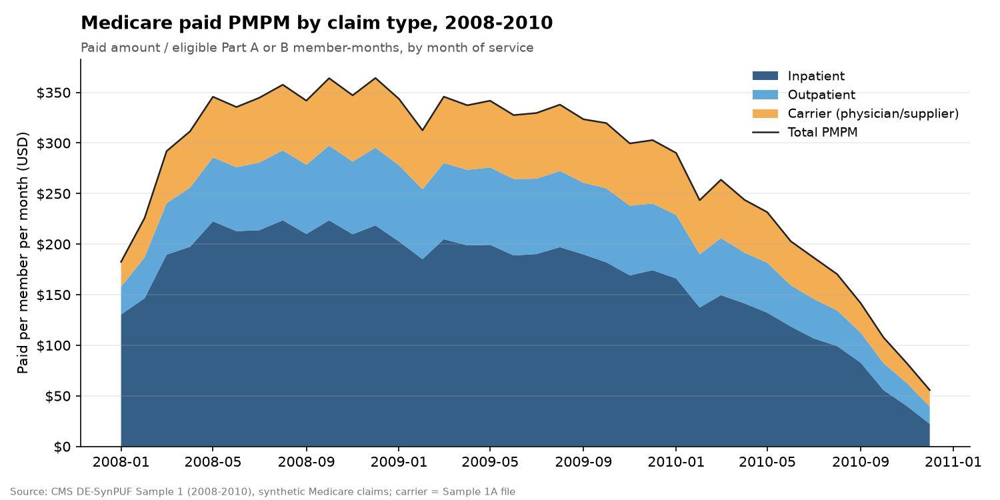
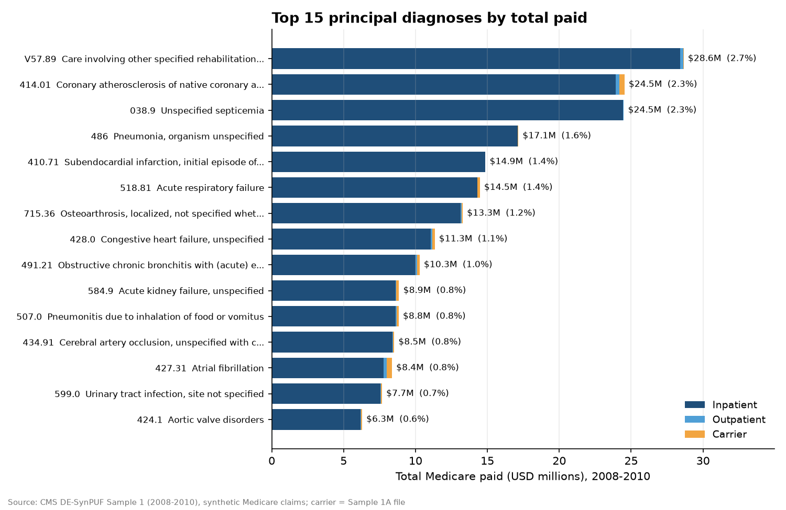
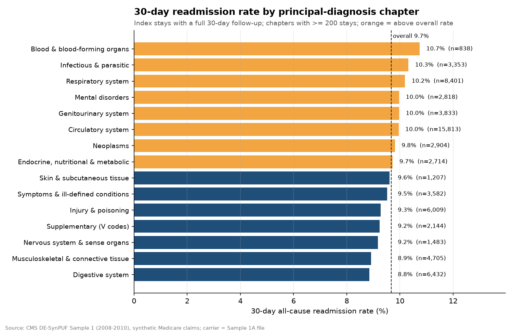
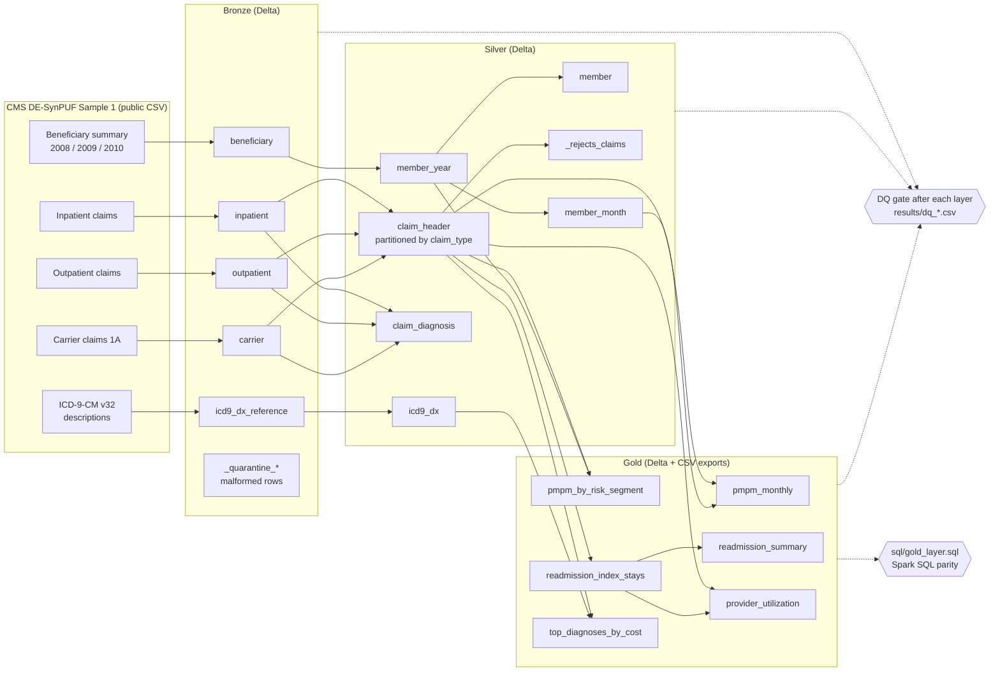

# Healthcare Claims Lakehouse (CMS DE-SynPUF, PySpark + Delta Lake)

A medallion (bronze → silver → gold) lakehouse built on **3.57 million real-format Medicare claim and enrollment
records** from the CMS 2008-2010 Data Entrepreneurs' Synthetic Public Use File (DE-SynPUF), Sample 1. PySpark does
the work, Delta Lake stores every layer, a data-quality gate runs after each layer, Spark SQL re-derives the gold
marts for a parity check, and Airflow orchestrates it. The same code runs as Databricks notebooks.

The gold layer answers payer-analytics questions: **cost per member per month (PMPM)**, **30-day all-cause
readmissions**, **which diagnoses drive spend**, **how cost scales with chronic-condition burden**, and
**provider utilization**.

> DE-SynPUF is fully synthetic: it keeps the file layouts, code sets and rough distributions of real Medicare
> fee-for-service claims, but no real beneficiary is in it. CMS warns it should not be used for clinical
> inference. The numbers below describe this synthetic sample, not Medicare.

## Headline results (from `results/`)

| Metric | Value |
|---|---|
| Members (unique beneficiaries) | 116,352 |
| Eligible member-months (Part A or B), 2008-2010 | 3,856,556 |
| Claims in silver `claim_header` (IP / OP / carrier) | 3,216,909 (66,705 / 779,537 / 2,370,667) |
| Diagnosis rows in silver `claim_diagnosis` | 7,666,162 |
| Total Medicare paid, 2008-2010 | $1,067.6M (inpatient 59.6%, outpatient 21.0%, carrier 19.4%) |
| **PMPM, all 36 months** | **$276.82** (2008 $316.66 · 2009 $326.83 · 2010 $185.45) |
| **30-day all-cause readmission rate** | **9.67%** (6,421 of 66,393 index stays with full follow-up) |
| Top principal diagnosis by paid | V57.89 rehabilitation care: $28.6M, 2.7% of all paid |
| PMPM, 5+ chronic conditions vs none (2008) | $1,052.52 vs $14.43 (73×) |
| Data-quality checks (bronze + silver + gold) | **56 checks: 55 pass, 1 warn, 0 fail** |
| Spark SQL vs PySpark gold parity | 6 of 6 marts match row for row (`results/sql_parity.csv`) |







**Reading the numbers honestly**

- **Carrier is the Sample 1A file only.** CMS splits Sample 1 carrier claims into files 1A and 1B; this project
  loads all 2,370,667 rows of 1A (1.24 GB) and nothing was sub-sampled. As a cross-check, the 1A claims carry
  $207.3M of carrier payments versus $384.0M of carrier reimbursement recorded in the beneficiary summary files
  (54%), so **carrier PMPM is understated by roughly half**. `python scripts/download_data.py --carrier-b`
  adds 1B (add its file name to `config.SOURCES["carrier"]`). Inpatient claims reconcile to 98.6% of the
  beneficiary-file inpatient reimbursement.
- **The 2010 drop-off is in the source, not the pipeline.** Paid amounts fall through 2010 (PMPM $290 in Jan to
  $56 in Dec) and the beneficiary summary files show the same fall (2010 inpatient reimbursement is 54% of
  2008's). The readmission rate by discharge year falls with it (14.5% → 7.4% → 4.3%) because fewer follow-up
  stays exist in the data to be counted.
- **Readmission rates barely differ by diagnosis chapter (8.8% to 10.7%).** The synthesis process perturbs
  each claim independently, which weakens real clinical links between an index stay and the next admission. The
  mart logic is the point here, not the clinical finding.

## Architecture



Orchestration (`dags/claims_lakehouse_dag.py`, Airflow 2.10):

```
start → download_raw → bronze_ingest → silver_conform → gold_marts → [gold_sql_parity, figures] → end
```

Each layer task runs `python -m src.lakehouse.pipeline --layer <x> --strict`, which exits 1 when an error-level DQ
check fails, so a bad load never reaches the next layer. Setting `CLAIMS_LAKEHOUSE_ON_DATABRICKS=true` swaps the
Bash tasks for `DatabricksSubmitRunOperator` runs of `notebooks/databricks/0x_*.py`.

## What each layer does

**Bronze** (`src/lakehouse/bronze.py`): reads each CSV with an explicit schema that mirrors the published header
(the header is checked against `config.py` first, so a drifted file is refused), sends malformed rows to a
`_quarantine_<table>` Delta table instead of failing, and adds `_source_file` and `_ingest_ts` lineage columns.
Delta schema enforcement is tested on purpose: the DQ step tries to append a drifted frame and expects Delta to
reject it.

**Silver** (`src/lakehouse/silver.py`, `transforms.py`):
- `member_year` decodes sex, race and the 11 chronic-condition flags and computes `member_months` as months of
  Part A or Part B coverage; `member` keeps the latest year per beneficiary with a SHA-256 surrogate key;
  `member_month` expands coverage into one row per member per month (the PMPM denominator).
- `claim_header` conforms inpatient, outpatient and carrier claims to one schema. Institutional claims that
  arrive in two `SEGMENT`s are rolled up to one claim (payments summed, earliest from-date, latest thru-date);
  carrier claims sum their 13 line payments. Claims with no member or unusable dates go to `_rejects_claims`
  with a reason.
- `claim_diagnosis` explodes every diagnosis position into one row with the ICD-9 code normalized
  (`4280` → `428.0`), its 3-digit category, chapter and a validity flag.

**Gold** (`src/lakehouse/gold.py`, mirrored in `sql/gold_layer.sql`):
- `pmpm_monthly`: paid by claim type ÷ eligible member-months, per service month.
- `pmpm_by_risk_segment`: PMPM by coverage year × chronic-condition-count bucket.
- `readmission_index_stays` / `readmission_summary`: every inpatient stay flagged when the member's next admission
  is 1-30 days after discharge (a same-day admission is treated as a transfer). Stays discharged in the last 30
  days of data have no full follow-up window and are excluded from rates.
- `top_diagnoses_by_cost`: principal diagnoses ranked by total paid, with CMS long descriptions.
- `provider_utilization`: claims, members, paid, average length of stay and readmission rate per provider.

## Data quality (`results/dq_report.csv`)

| Layer | Checks | Pass | Warn | Fail | Examples |
|---|---|---|---|---|---|
| Bronze | 21 | 21 | 0 | 0 | raw CSV lines = loaded + quarantined for all 4 sources; no duplicate claim keys; Delta rejects schema drift |
| Silver | 27 | 26 | 1 | 0 | bronze → silver row gap fully explained (68 IP and 10,975 OP extra segments collapsed, 278 OP claims rejected); paid amount conserved to the cent (IP $639,260,180, OP $224,132,390); 0 orphan claims or diagnoses |
| Gold | 8 | 8 | 0 | 0 | gold paid = silver paid; one index row per inpatient claim; readmission rate in a plausible band |

The one warning is real and kept visible: **2,612 claims have a negative paid amount** (adjustments in the source).
Other monitored rates: 0.14% of claims lack a provider id, 0.004% lack a principal diagnosis, 516 of 7.67M
diagnosis codes are malformed, 2.7% of diagnosis codes are not in the FY2015 billable list (3-digit and retired
codes), and 0.67% of claims fall in a month the member had no Part A/B coverage.

## Run it

Needs Python 3.12 and a Java 17 runtime (`JAVA_HOME`). Tested on Temurin 17.0.20 with pyspark 3.5.3 and
delta-spark 3.2.1 in local mode with a 3 GB driver.

```bash
pip install -r requirements.txt
python scripts/download_data.py                      # ~1.5 GB of CMS CSVs into data/raw (git-ignored)

python -m src.lakehouse.pipeline --layer bronze      # raw CSV -> bronze Delta + DQ
python -m src.lakehouse.pipeline --layer silver      # bronze -> silver + DQ        (~13 min locally)
python -m src.lakehouse.pipeline --layer gold        # silver -> gold + DQ + results/gold_*.csv (~2.5 min)
python -m src.run_gold_sql                           # Spark SQL gold vs PySpark gold -> results/sql_parity.csv
python -m src.make_figures                           # figures/*.png from results/

pytest -q tests                                      # unit tests for the transforms (local Spark)
pip install -r requirements-airflow.txt && python scripts/check_dag.py   # DAG import + task order check
```

Useful environment variables: `SPARK_DRIVER_MEMORY` (default `3g`), `LAKEHOUSE_FORMAT=parquet` to skip Delta,
`LAKEHOUSE_ROOT` / `LAKEHOUSE_RAW` to point at another location (for example a Unity Catalog Volume on Databricks).

## Repository layout

```
src/lakehouse/      config (schemas, sources), io (Spark + Delta), bronze, silver, gold, transforms, dq, pipeline CLI
src/run_gold_sql.py Spark SQL parity runner          src/make_figures.py   README figures
sql/gold_layer.sql  the gold layer in Spark SQL      dags/                 Airflow DAG
notebooks/databricks/  the same pipeline as Databricks notebooks
scripts/            download_data.py, check_dag.py   tests/                pytest unit tests
results/            DQ reports, run logs, gold CSV exports, SQL parity   figures/   PNG charts
```

## Data source

CMS, *2008-2010 Data Entrepreneurs' Synthetic Public Use File (DE-SynPUF)*, Sample 1:
<https://www.cms.gov/data-research/statistics-trends-and-reports/medicare-claims-synthetic-public-use-files/cms-2008-2010-data-entrepreneurs-synthetic-public-use-file-de-synpuf/de10-sample-1>.
ICD-9-CM diagnosis descriptions: CMS ICD-9-CM v32 (FY2015) master descriptions. Both are free public downloads.

## License

MIT, see `LICENSE`.
